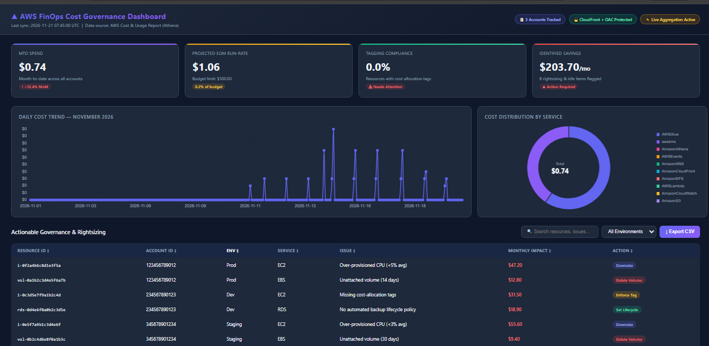
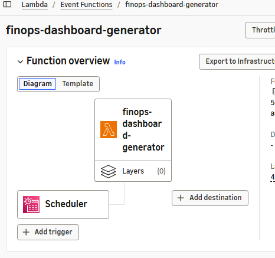
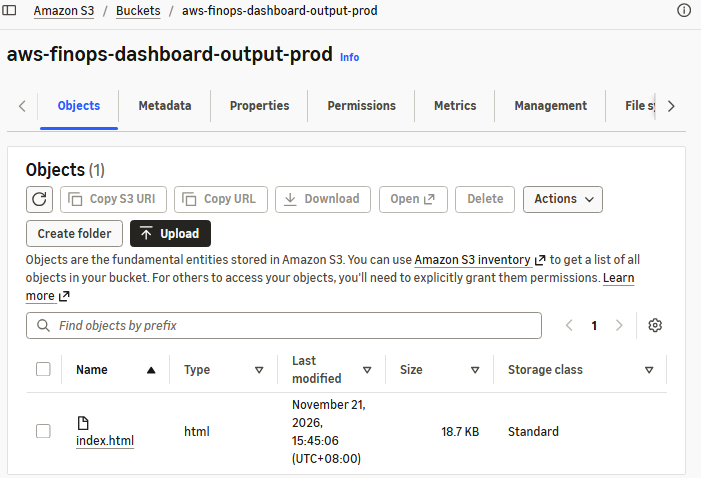
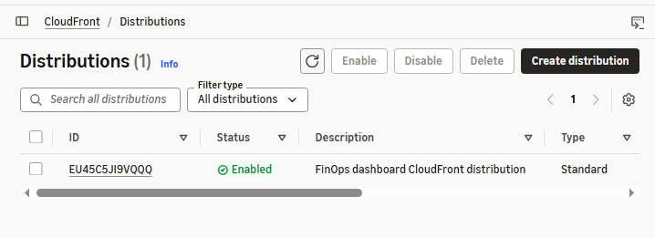

# AWS FinOps Dashboard — Full Project Documentation

## 📋 Table of Contents
1. [Project Overview](#overview)
2. [Architecture](#architecture)
3. [Services Used](#services)
4. [Step-by-Step Build Process](#process)
5. [Challenges & Solutions](#challenges)
6. [Screenshots & Proof of Work](#screenshots)
7. [Future Work](#future)

---

## 1. Project Overview
A fully serverless, automated FinOps dashboard built on AWS.
It automatically generates and serves cloud cost/usage data 
on a schedule — no servers, no manual work.

**Live Demo:** https://deu44mf4thraz.cloudfront.net  
**GitHub:** https://github.com/MuriamLuqman6607/aws-finops-dashboard

---

## 2. Architecture


**Security Note:**
IAM and KMS are cross-cutting concerns that protect 
every layer — not a standalone layer. This follows the 
AWS Well-Architected Framework Security Pillar.

**Flow:**
```
┌─────────────────────────────────────────┐
│  🔐 IAM + KMS — Spans All Layers        │
│                                          │
│  DATA:       Glue → Athena → S3         │
│       ↓                                  │
│  PROCESSING: EventBridge → Lambda       │
│       ↓                                  │
│  STORAGE:    S3 + KMS Encryption        │
│       ↓                                  │
│  DELIVERY:   ACM → CloudFront           │
│                                          │
└─────────────────────────────────────────┘
              ↓
       [End User/Browser]
```

---

## 3. Services Used

### Core Services
| AWS Service | Layer | Purpose |
|---|---|---|
| AWS Glue | Data | ETL processing of cost data |
| Amazon Athena | Data | SQL querying of cost data |
| Amazon S3 | Data + Storage | Raw data + dashboard output |
| Amazon EventBridge | Processing | Scheduled automation trigger |
| AWS Lambda | Processing | Dashboard HTML generation |
| Amazon CloudFront | Delivery | Global secure CDN delivery |
| AWS ACM | Delivery | SSL/TLS certificate management |

### Cross-Cutting Security Services
| AWS Service | Covers | Purpose |
|---|---|---|
| AWS IAM | All Layers | Roles, policies & access control |
| AWS KMS | All Layers | Encryption key management |


---

## 4. Step-by-Step Build Process

### Step 1 — Lambda Function
- Created `finops-dashboard-generator` Lambda function
- Configured IAM role with S3 and KMS permissions
- Function generates HTML dashboard and uploads to S3

### Step 2 — S3 Bucket Setup
- Created private S3 bucket `aws-finops-dashboard-output-prod`
- Enabled KMS encryption (Customer Managed Key)
- Blocked all public access
- Configured bucket policy for CloudFront OAC only

### Step 3 — CloudFront Distribution
- Created CloudFront distribution with OAC (Origin Access Control)
- Pointed origin to private S3 bucket
- Configured KMS key policy to allow CloudFront decryption
- Default root object set to `index.html`

### Step 4 — EventBridge Schedule
- Created EventBridge rule to trigger Lambda automatically
- Dashboard auto-refreshes on schedule

---

## 5. Challenges & Solutions

| Challenge | Solution |
|---|---|
| CloudFront could not decrypt KMS encrypted S3 files | Added `kms:Decrypt` to KMS key policy for CloudFront OAC |
| S3 blocking CloudFront access | Configured OAC + updated S3 bucket policy |
| Lambda missing S3 write permissions | Updated IAM execution role with least privilege policy |
| Security needed across all layers | Applied IAM roles and KMS encryption at every layer individually |


---

## 6. Screenshots & Proof of Work
     
### Live Dashboard


### Lambda Function


### S3 Bucket Configuration


### CloudFront Distribution


### EventBridge Schedule


---

## 7. Future Work

### Security Enhancements
- [ ] Add Amazon Cognito for user authentication
- [ ] Enable AWS WAF on CloudFront distribution
- [ ] Add AWS Config rules for compliance monitoring
- [ ] Enable AWS CloudTrail for full audit logging

### Feature Enhancements
- [ ] Add custom domain with Route 53
- [ ] Multi-account support via AWS Organizations
- [ ] Add CloudWatch alarms for cost anomaly detection
- [ ] Expand dashboard with more cost metrics and filters
- [ ] Add cost forecasting with AWS Cost Explorer API


---

## 👤 Author
**Muriam Luqman**  
[LinkedIn](your-linkedin-url)  
[Upwork](your-upwork-url)
