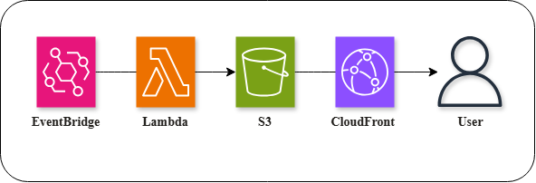

# AWS FinOps Dashboard — Full Project Documentation

## 📋 Table of Contents
1. [Project Overview](#overview)
2. [Architecture](#architecture)
3. [Services Used](#services)
4. [Step-by-Step Build Process](#process)
5. [Challenges & Solutions](#challenges)
6. [Screenshots & Proof of Work](#screenshots)
7. [Future Work](#future)

---

## 1. Project Overview
A fully serverless, automated FinOps dashboard built on AWS.
It automatically generates and serves cloud cost/usage data 
on a schedule — no servers, no manual work.

**Live Demo:** https://deu44mf4thraz.cloudfront.net  
**GitHub:** https://github.com/MuriamLuqman6607/aws-finops-dashboard

---

## 2. Architecture

**Flow:**
EventBridge (Scheduler) → Lambda (Generator) → S3 (Encrypted Storage) → CloudFront (CDN) → End User

---

## 3. Services Used
| AWS Service | Purpose |
|---|---|
| AWS Lambda | Generates dashboard HTML automatically |
| Amazon S3 | Stores dashboard files (KMS encrypted) |
| Amazon CloudFront | Delivers dashboard globally via CDN |
| Amazon EventBridge | Triggers Lambda on a schedule |
| AWS KMS | Encrypts data at rest |
| AWS IAM | Manages permissions and access control |

---

## 4. Step-by-Step Build Process

### Step 1 — Lambda Function
- Created `finops-dashboard-generator` Lambda function
- Configured IAM role with S3 and KMS permissions
- Function generates HTML dashboard and uploads to S3

### Step 2 — S3 Bucket Setup
- Created private S3 bucket `aws-finops-dashboard-output-prod`
- Enabled KMS encryption (Customer Managed Key)
- Blocked all public access
- Configured bucket policy for CloudFront OAC only

### Step 3 — CloudFront Distribution
- Created CloudFront distribution with OAC (Origin Access Control)
- Pointed origin to private S3 bucket
- Configured KMS key policy to allow CloudFront decryption
- Default root object set to `index.html`

### Step 4 — EventBridge Schedule
- Created EventBridge rule to trigger Lambda automatically
- Dashboard auto-refreshes on schedule

---

## 5. Challenges & Solutions
| Challenge | Solution |
|---|---|
| CloudFront could not read KMS encrypted S3 files | Added `kms:Decrypt` permission to KMS key policy for CloudFront OAC |
| S3 bucket blocking CloudFront access | Configured OAC and updated S3 bucket policy |
| Lambda missing S3 write permissions | Updated IAM execution role with correct S3 and KMS policies |

---

## 6. Screenshots & Proof of Work

### Live Dashboard

### Lambda Function

### S3 Bucket Configuration

### CloudFront Distribution

### EventBridge Schedule

---

## 7. Future Work
- [ ] Add custom domain with Route 53 and SSL certificate
- [ ] Add authentication with Amazon Cognito
- [ ] Expand dashboard with more cost metrics and filters
- [ ] Add CloudWatch alarms for cost anomaly detection
- [ ] Multi-account support using AWS Organizations

---

## 👤 Author
**Muriam Luqman**  
[LinkedIn](your-linkedin-url)  
[Upwork](your-upwork-url)
