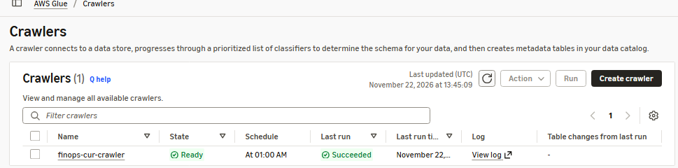
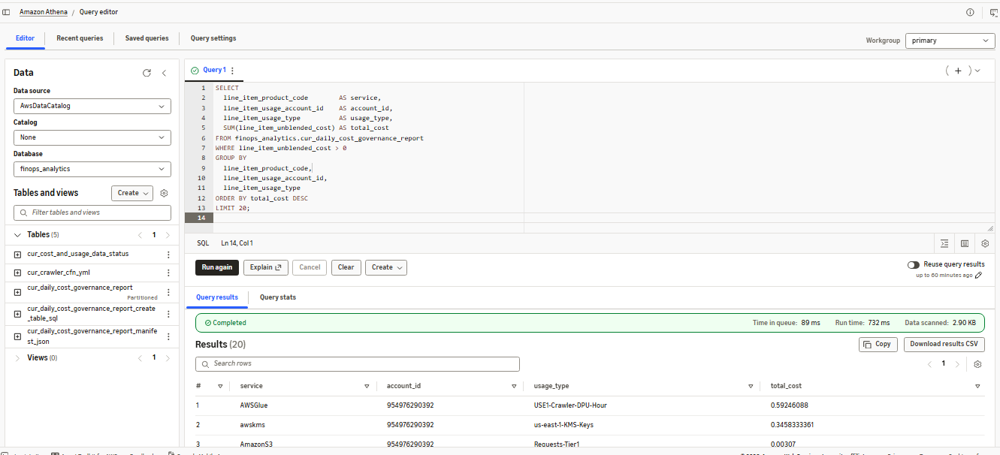
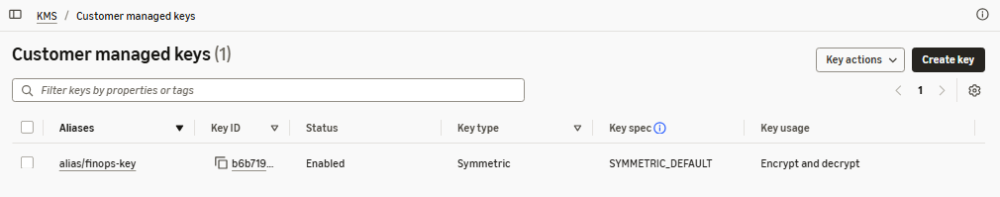
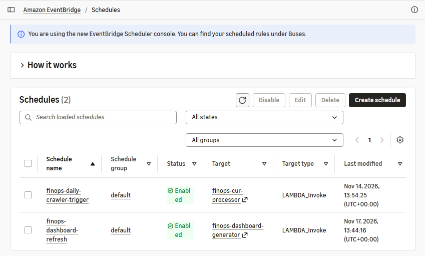

# AWS FinOps Dashboard - Full Project Documentation

## 📋 Table of Contents
1. [Project Overview](#overview)
2. [Architecture](#architecture)
3. [Services Used](#services)
4. [Step-by-Step Build Process](#process)
5. [Challenges & Solutions](#challenges)
6. [Screenshots & Proof of Work](#screenshots)
7. [Future Work](#future)

---

## 1. Project Overview
A fully serverless, automated FinOps dashboard built on AWS.
It automatically generates and serves cloud cost and usage data
on a schedule — no servers, no manual work.

**Live Demo:** https://deu44mf4thraz.cloudfront.net
**GitHub:** https://github.com/MuriamLuqman6607/aws-finops-dashboard

**What this project demonstrates:**
- End-to-end serverless AWS architecture
- Data pipeline with Glue + Athena
- Security best practices across all layers
- Automated scheduling and deployment
- Cost optimization with minimal infrastructure

---

## 2. Architecture


### ACM Certificate
CloudFront provides built-in HTTPS via AWS managed 
certificate on the *.cloudfront.net domain.
Custom domain with ACM is listed under Future Work.

**Security Note:**
IAM and KMS are cross-cutting concerns that protect every layer —
not a standalone layer. This follows the AWS Well-Architected
Framework Security Pillar.


**Flow:**
```
┌─────────────────────────────────────────────────────────────────┐
│                         AWS CLOUD                               │
│  ╔═══════════════════════════════════════════════════════════╗  │
│  ║             SECURITY (IAM + KMS) — All Layers             ║  │
│  ║                                                           ║  │
│  ║  ┌───────────────────────────────────────────────────┐    ║  │
│  ║  │                  DATA LAYER                       │    ║  │
│  ║  │  [AWS Glue] ──▶ [Amazon Athena] ──▶ [S3]         │    ║  │
│  ║  └──────────────────────┬────────────────────────────┘    ║  │
│  ║                         │                                 ║  │
│  ║  ┌──────────────────────▼────────────────────────────┐    ║  │
│  ║  │               PROCESSING LAYER                    │    ║  │
│  ║  │        [EventBridge] ──▶ [Lambda]                 │    ║  │
│  ║  └──────────────────────┬────────────────────────────┘    ║  │
│  ║                         │                                 ║  │
│  ║  ┌──────────────────────▼────────────────────────────┐    ║  │
│  ║  │                STORAGE LAYER                      │    ║  │
│  ║  │           [S3 Bucket] ◀── [KMS]                   │    ║  │
│  ║  └──────────────────────┬────────────────────────────┘    ║  │
│  ║                         │                                 ║  │
│  ║  ┌──────────────────────▼────────────────────────────┐    ║  │
│  ║  │                DELIVERY LAYER                     │    ║  │
│  ║  │        [ACM Certificate] ──▶ [CloudFront]         │    ║  │
│  ║  └──────────────────────┬────────────────────────────┘    ║  │
│  ║                         │                                 ║  │
│  ╚═══════════════════════════════════════════════════════════╝  │
└─────────────────────────────────────────────────────────────────┘
                             │
                   [End User / Browser]

```

---

## 3. Services Used

### Core Services
| AWS Service | Layer | Purpose |
|---|---|---|
| AWS Glue | Data | ETL processing of cost data |
| Amazon Athena | Data | SQL querying of cost data |
| Amazon S3 | Data + Storage | Raw data and dashboard output |
| Amazon EventBridge | Processing | Scheduled automation trigger |
| AWS Lambda | Processing | Dashboard HTML generation |
| Amazon CloudFront | Delivery | Global secure CDN delivery |
| AWS ACM | Delivery | SSL/TLS certificate management |

### Cross-Cutting Security Services
| AWS Service | Covers | Purpose |
|---|---|---|
| AWS IAM | All Layers | Roles, policies and access control |
| AWS KMS | All Layers | Encryption key management |

---

## 4. Step-by-Step Build Process

### Step 1 — AWS Glue Setup
- Created Glue crawler to crawl raw Cost and Usage Report data
- Configured Glue IAM role with S3 and KMS permissions
- Glue catalog table created for Athena to query

### Step 2 — Amazon Athena Setup
- Configured Athena workgroup with S3 output location
- Created SQL queries to extract cost and usage metrics
- Tested queries against Glue catalog table

### Step 3 — Lambda Function
- Created `finops-dashboard-generator` Lambda function
- Configured IAM execution role with least privilege:
  - S3 read and write permissions
  - KMS encrypt and decrypt permissions
  - Athena query execution permissions
- Function reads Athena results and generates HTML dashboard
- Uploads generated dashboard to S3 output bucket

### Step 4 — S3 Bucket Setup
- Created private S3 bucket `aws-finops-dashboard-output-prod`
- Enabled KMS encryption with Customer Managed Key
- Blocked all public access
- Configured bucket policy for CloudFront OAC access only

### Step 5 — AWS KMS Setup
- Created Customer Managed Key (CMK)
- Configured key policy to allow:
  - Lambda to encrypt and decrypt
  - CloudFront OAC to decrypt
  - S3 to use for server-side encryption

### Step 6 — ACM Certificate
- Requested SSL/TLS certificate via AWS Certificate Manager
- Validated domain ownership
- Certificate attached to CloudFront distribution

### Step 7 — CloudFront Distribution
- Created CloudFront distribution with OAC (Origin Access Control)
- Pointed origin to private S3 bucket
- Attached ACM SSL certificate for HTTPS
- Configured KMS key policy to allow CloudFront decryption
- Default root object set to `index.html`

### Step 8 — EventBridge Schedule
- Created EventBridge rule to trigger Lambda automatically
- Configured cron schedule for auto-refresh
- Dashboard updates automatically on schedule

### Step 9 — IAM Roles and Policies
- Created least privilege IAM roles for each service:
  - Lambda execution role
  - Glue crawler role
  - CloudFront OAC role
- Applied IAM policies across all layers individually

---

## 5. Challenges & Solutions

| Challenge | Solution |
|---|---|
| CloudFront could not decrypt KMS encrypted S3 files | Added `kms:Decrypt` to KMS key policy for CloudFront OAC |
| S3 blocking CloudFront access | Configured OAC and updated S3 bucket policy |
| Lambda missing S3 write permissions | Updated IAM execution role with least privilege policy |
| Athena query results not accessible to Lambda | Added Athena and S3 output bucket permissions to Lambda role |
| Security needed across all layers | Applied IAM roles and KMS encryption at every layer individually |

---

## 6. Screenshots & Proof of Work

### Live Dashboard


### AWS Glue Crawler


### Amazon Athena Query


### Lambda Function


### S3 Bucket Configuration


### KMS Key Configuration


### CloudFront Distribution


### EventBridge Schedule


---

## 7. Future Work

### Security Enhancements
- [ ] Add Amazon Cognito for user authentication
- [ ] Enable AWS WAF on CloudFront distribution
- [ ] Add AWS Config rules for compliance monitoring
- [ ] Enable AWS CloudTrail for full audit logging

### Feature Enhancements
- [ ] Add custom domain with Route 53
- [ ] Multi-account support via AWS Organizations
- [ ] Add CloudWatch alarms for cost anomaly detection
- [ ] Expand dashboard with more cost metrics and filters
- [ ] Add cost forecasting with AWS Cost Explorer API

### Infrastructure Enhancements
- [ ] Add custom domain with Route 53
- [ ] Request ACM certificate for custom domain
- [ ] Attach ACM certificate to CloudFront distribution

---

## 👤 Author
**Muriam Luqman**
[LinkedIn](https://www.linkedin.com/in/muriam-luqman) |
[Upwork](https://www.upwork.com/freelancers/~01a2339d99116be636?mp_source=share) |
