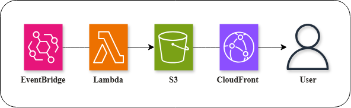

# AWS FinOps Dashboard

A serverless, automated FinOps dashboard built on AWS to visualize 
cloud cost and usage data in real time.

## 🔗 Live Demo
👉 https://deu44mf4thraz.cloudfront.net

## 📌 Overview
This project automatically generates and serves a FinOps dashboard 
using a fully serverless AWS architecture. The dashboard refreshes 
automatically on a schedule and is securely delivered via CloudFront.

## 🏗️ Architecture
┌─────────────────────────────────────────────────────┐
│                   DATA LAYER                         │
│  AWS Glue (ETL) → Athena (Query) → S3 (Raw Storage) │
└─────────────────────┬───────────────────────────────┘
                      │
┌─────────────────────▼───────────────────────────────┐
│                PROCESSING LAYER                      │
│  EventBridge (Scheduler) → Lambda (Generator)        │
└─────────────────────┬───────────────────────────────┘
                      │
┌─────────────────────▼───────────────────────────────┐
│                STORAGE LAYER                         │
│  S3 (Dashboard Output) + KMS (Encryption)            │
└─────────────────────┬───────────────────────────────┘
                      │
┌─────────────────────▼───────────────────────────────┐
│                DELIVERY LAYER                        │
│  ACM (SSL Certificate) → CloudFront (CDN)            │
└─────────────────────┬───────────────────────────────┘
                      │
┌─────────────────────▼───────────────────────────────┐
│                SECURITY LAYER                        │
│  IAM (Roles & Policies) + KMS (Key Management)       │
└─────────────────────────────────────────────────────┘
                      │
                 [End User/Browser]

## 🛠️ Tech Stack
| AWS Service | Purpose |
|---|---|
| AWS Lambda | Automated dashboard generation |
| Amazon S3 | Secure encrypted file storage |
| Amazon CloudFront | Global CDN secure delivery |
| Amazon EventBridge | Scheduled automation |
| AWS Glue | ETL data processing |
| Amazon Athena | SQL querying of cost data |
| AWS KMS | Encryption key management |
| AWS ACM | SSL/TLS certificate management |
| AWS IAM | Roles, policies & access control |

## ✨ Features
- Fully serverless — no servers to manage
- Auto-refreshes on a schedule via EventBridge
- Encrypted at rest with AWS KMS
- Privately stored in S3, served securely via CloudFront
- Read-only public access via CloudFront URL

## 📷 Dashboard Preview

## 👤 Author
Muriam Luqman
www.linkedin.com/in/muriam-luqman
https://www.upwork.com/freelancers/~01a2339d99116be636?mp_source=share
