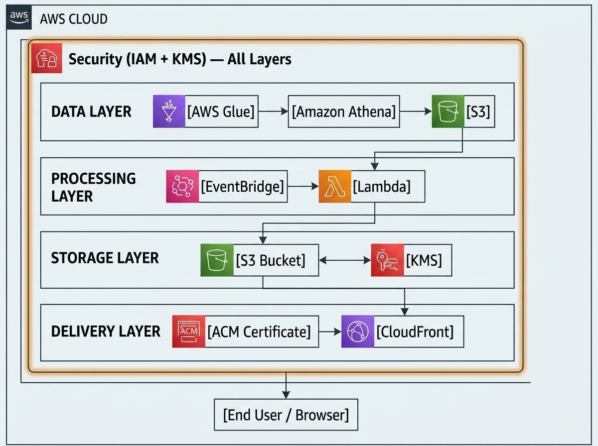

# AWS FinOps Dashboard

A serverless, automated FinOps dashboard built on AWS to visualize 
cloud cost and usage data in real time.

## 🔗 Live Demo
👉 https://deu44mf4thraz.cloudfront.net

💻 **GitHub:** https://github.com/MuriamLuqman6607/aws-finops-dashboard

## 📌 Overview
This project automatically generates and serves a FinOps dashboard 
using a fully serverless AWS architecture. The dashboard refreshes 
automatically on a schedule and is securely delivered via CloudFront.

**What this project demonstrates:**
- End-to-end serverless AWS architecture
- Data pipeline with Glue + Athena
- Security best practices across all layers
- Automated scheduling and deployment
- Cost optimization with minimal infrastructure

## 🏗️ Architecture

**Security Note:**
IAM and KMS are cross-cutting concerns that protect every layer —
not a standalone layer. This follows the AWS Well-Architected 
Framework Security Pillar.

```
┌─────────────────────────────────────────────────────────────────┐
│                         AWS CLOUD                               │
│  ╔═══════════════════════════════════════════════════════════╗  │
│  ║             SECURITY (IAM + KMS) — All Layers             ║  │
│  ║                                                           ║  │
│  ║  ┌───────────────────────────────────────────────────┐    ║  │
│  ║  │                  DATA LAYER                       │    ║  │
│  ║  │  [AWS Glue] ──▶ [Amazon Athena] ──▶ [S3]         │    ║  │
│  ║  └──────────────────────┬────────────────────────────┘    ║  │
│  ║                         │                                 ║  │
│  ║  ┌──────────────────────▼────────────────────────────┐    ║  │
│  ║  │               PROCESSING LAYER                    │    ║  │
│  ║  │        [EventBridge] ──▶ [Lambda]                 │    ║  │
│  ║  └──────────────────────┬────────────────────────────┘    ║  │
│  ║                         │                                 ║  │
│  ║  ┌──────────────────────▼────────────────────────────┐    ║  │
│  ║  │                STORAGE LAYER                      │    ║  │
│  ║  │           [S3 Bucket] ◀── [KMS]                   │    ║  │
│  ║  └──────────────────────┬────────────────────────────┘    ║  │
│  ║                         │                                 ║  │
│  ║  ┌──────────────────────▼────────────────────────────┐    ║  │
│  ║  │                DELIVERY LAYER                     │    ║  │
│  ║  │        [ACM Certificate] ──▶ [CloudFront]         │    ║  │
│  ║  └──────────────────────┬────────────────────────────┘    ║  │
│  ║                         │                                 ║  │
│  ╚═══════════════════════════════════════════════════════════╝  │
└─────────────────────────────────────────────────────────────────┘
                             │
                   [End User / Browser]

```



## 🛠️ Tech Stack

### Core Services
| AWS Service | Layer | Purpose |
|---|---|---|
| AWS Glue | Data | ETL processing of cost data |
| Amazon Athena | Data | SQL querying of cost data |
| Amazon S3 | Data + Storage | Raw data and dashboard output |
| Amazon EventBridge | Processing | Scheduled automation trigger |
| AWS Lambda | Processing | Dashboard HTML generation |
| Amazon CloudFront | Delivery | Global secure CDN delivery |
| AWS ACM | Delivery | SSL/TLS certificate management |

### Cross-Cutting Security Services
| AWS Service | Covers | Purpose |
|---|---|---|
| AWS IAM | All Layers | Roles, policies and access control |
| AWS KMS | All Layers | Encryption key management |

---

## ✨ Key Features
- Fully automated — no manual intervention needed
- Encrypted at rest with AWS Customer Managed KMS Key
- Secured with CloudFront OAC (no public S3 access)
- HTTPS enforced via ACM SSL certificate
- IAM least privilege access across all services
- SQL cost querying via Athena + Glue ETL pipeline
- Scheduled auto-refresh via EventBridge

---

## 🔐 Security Highlights
- S3 bucket is **fully private** — no public access
- CloudFront uses **OAC** (Origin Access Control)
- All data encrypted with **Customer Managed KMS Key**
- HTTPS enforced via **ACM SSL certificate**
- Lambda runs with **least privilege IAM role**
- IAM and KMS protect **every layer** individually

---

## 🚀 How It Works

1. **AWS Glue** crawls and processes raw Cost & Usage Report data
2. **Amazon Athena** runs SQL queries against the processed data
3. **Amazon EventBridge** triggers Lambda automatically on schedule
4. **AWS Lambda** reads Athena results and generates dashboard HTML
5. **Amazon S3** stores the dashboard file — encrypted by KMS
6. **Amazon CloudFront** delivers the dashboard securely via HTTPS
7. **ACM Certificate** ensures encrypted delivery to the end user

---

## 🔮 Future Work

### Security Enhancements
- [ ] Add Amazon Cognito for user authentication
- [ ] Enable AWS WAF on CloudFront distribution
- [ ] Add AWS Config rules for compliance monitoring
- [ ] Enable AWS CloudTrail for full audit logging

### Feature Enhancements
- [ ] Add custom domain with Route 53
- [ ] Multi-account support via AWS Organizations
- [ ] Add CloudWatch alarms for cost anomaly detection
- [ ] Expand dashboard with more cost metrics and filters
- [ ] Add cost forecasting with AWS Cost Explorer API

---

## 📷 Dashboard Preview


## 👤 Author
Muriam Luqman

www.linkedin.com/in/muriam-luqman

https://www.upwork.com/freelancers/~01a2339d99116be636?mp_source=share
